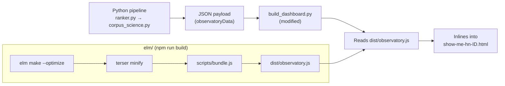

# Elm Types for HN Epistemic Observatory Display Layer

> Target: **Elm 0.19.3** (October 2026) — no breaking changes from 0.19.1 API surface.
>
> Scope: Every type needed to replace the HTML/CSS/JS rendering in
> `build_dashboard.py` (single-story observatory) and `build_pages_site.py`
> (index page + item router) with an Elm SPA that consumes the same
> `<script id="observatoryData" type="application/json">` payload the
> Python pipeline already emits.

---

## 1. JSON Payload Root

The Python `build_dashboard.py` serialises a single JSON blob into the HTML.
This is the top-level Elm record that `Json.Decode` must hydrate.

```elm
type alias ObservatoryPayload =
    { storyId : Int
    , storyTitle : String
    , storyUrl : String
    , isBenchmark : Bool
    , manifest : Manifest
    , judge : Maybe JudgeResult
    , weights : Weights
    , tiers : TierCounts
    , facets : FacetCounts
    , facetOptions : List FacetOption
    , facetDiagnostics : List FacetDiagnostic
    , sourceCategories : List SourceCategory
    , storyAnchors : List String
    , largestRoot : LargestRoot
    , buriedCutoff : Int
    , rescueTopK : Int
    , ablations : List AblationRow
    , tournament : List TournamentRow
    , comments : List CompactComment
    }
```

---

## 2. Manifest & Story Metadata

```elm
type alias Manifest =
    { storyTitle : String
    , storyUrl : String
    , points : Int
    , storyAuthor : String
    , t2RefUtc : String              -- ISO-8601 reference timestamp
    , deltaMinutes : Float
    , counts : ManifestCounts
    , facetLabels : Dict String String
    , facetClusters : List FacetCluster
    , storyAnchors : List String
    }


type alias ManifestCounts =
    { totalComments : Int
    , uniqueAuthorsProfiled : Int
    , pagesFetched : Int
    }


type alias FacetCluster =
    { slug : String
    , topTerms : List String
    }
```

---

## 3. Epistemic Weights (Tuner Sliders)

```elm
type alias Weights =
    { infoGain : Float
    , falsifiability : Float
    , gravityProgeny : Float
    , bullshitPenalty : Float
    , downvotePenalty : Float
    , mmrSimLambda : Float
    , mmrRootLambda : Float
    , mmrFacetLambda : Float
    }
```

---

## 4. Tier & Facet Enums

```elm
{-| The five epistemic quality tiers assigned by ranker.py.
    Ordered from best to worst for display/border-colour logic.
-}
type Tier
    = EpistemicGold
    | GroundedAnalysis
    | CrowdChatter
    | MemeOrSnark
    | BullshitOrFlamewar
    | DownvotedSink


{-| Counts per tier in the full corpus. Keys mirror `Tier` constructor names. -}
type alias TierCounts =
    { epistemicGold : Int
    , groundedAnalysis : Int
    , crowdChatter : Int
    , memeOrSnark : Int
    , bullshitOrFlamewar : Int
    , downvotedSink : Int
    }


{-| Counts per auto-discovered k-means++ facet slug. -}
type alias FacetCounts =
    Dict String Int


type alias FacetOption =
    { slug : String
    , label : String
    , count : Int
    }


type alias FacetDiagnostic =
    { slug : String
    , label : String
    , count : Int
    , useful : Int
    , usefulPct : Float
    , terms : String
    }
```

---

## 5. Compact Comment (the main card data)

This mirrors the compact JSON `dict` built in `build_dashboard.py` lines 400-446.

```elm
type alias CompactComment =
    { id : Int
    , au : String                    -- author username
    , dom : Int                      -- live HN DOM rank (1-based)
    , sr : Int                       -- canonical signal rank
    , sc : Float                     -- canonical signal score
    , ep : Float                     -- epistemic potential (positive sum)
    , bs : Float                     -- bullshit load (negative sum)
    , d : Int                        -- comment depth
    , age : Float                    -- age in hours
    , grav : Float                   -- gravity denominator (T+2)^1.8
    , surf : Float                   -- surf mirage index
    , fade : String                  -- HN CSS fade class: "c00", "c5A", "c73"…"cDD"
    , dt : Int                       -- downvote tier (0=none, 1=c5A, 2+=deeper)
    , ut : Int                       -- URL source tier (-1..3)
    , lu : Int                       -- low-credibility URL count
    , w : Int                        -- own word count
    , qw : Int                       -- quoted word count
    , k : Int                        -- author karma
    , kpp : Float                    -- author karma-per-post
    , td : Float                     -- temporal percentile delta
    , mod : Int                      -- 1 if mod-rebuked, else 0
    , pp : Int                       -- ping-pong depth
    , meme : Int                     -- meme/running-gag hit count
    , tier : Tier
    , facet : String                 -- facet slug
    , flbl : String                  -- facet human label
    , urls : List String             -- up to 3 external citation URLs
    , ig : Float                     -- raw info_gain component (pre-weight)
    , fa : Float                     -- raw falsifiability component
    , gp : Float                     -- raw gravity_progeny component
    , bl : Float                     -- raw bullshit_load component
    , ds : Float                     -- raw downvote_sink component
    , txt : String                   -- comment body text (truncated ≤1400 chars)
    }
```

---

## 6. Benchmark-Only Types (Judge, Ablation, Tournament)

```elm
type alias JudgeResult =
    { judgeVersion : String
    , score : Float
    , devScore : Float
    , holdoutScore : Float
    , deltaVsHn : Float
    , hnLiveBaselineScore : Float
    , fullMetrics : JudgeMetrics
    }


type alias JudgeMetrics =
    { ndcg20 : Float
    , pairwiseConcordance : Float
    , adversarialAcc : Float
    , buriedGoldRecallTop45 : Float
    , bullshitSinkPercentile : Float
    , top20Diversity : Float
    }


type alias AblationRow =
    { name : String
    , score : Float
    , ndcg20 : Float
    , pairwiseConcordance : Float
    , adversarialAcc : Float
    , buriedGoldRecallTop45 : Float
    , bullshitSinkPercentile : Float
    , top20Diversity : Float
    }


type alias TournamentRow =
    { stage : String
    , sha : String
    , score : Float
    , devScore : Float
    , holdoutScore : Float
    , disposition : String           -- "promoted_champion", "promoted_best", etc.
    }
```

---

## 7. Source Registry

```elm
type alias SourceCategory =
    { category : String
    , count : Int
    }
```

---

## 8. Largest Root Subtree (Tree-Lock diagnostic)

```elm
type alias LargestRoot =
    { rootId : Int
    , author : String
    , slots : Int
    , startDom : Int
    , endDom : Int
    , sharePct : Float
    , topDom1Age : Float
    , topDom1Author : String
    }
```

---

## 9. Application Model (Elm `Model`)

```elm
type alias Model =
    { payload : ObservatoryPayload
    , currentWeights : CurrentWeights -- mutable slider state
    , activeMode : ViewMode
    , searchQuery : String
    , selectedFacet : String          -- "all" or a facet slug
    , selectedCommentId : Maybe Int   -- canvas probe selection
    , liveList : List LiveComment     -- recomputed on weight change
    , proofDrawerOpen : Bool
    , labDrawerOpen : Bool
    , viewport : Viewport
    }


type alias CurrentWeights =
    { ig : Float
    , fa : Float
    , gp : Float
    , bp : Float
    , dp : Float
    }


{-| Derived comment with live-recomputed score for the current slider weights. -}
type alias LiveComment =
    { comment : CompactComment
    , liveScore : Float
    , liveEp : Float                 -- max(0, positive sum)
    , liveBs : Float                 -- max(0, negative sum)
    , liveRank : Int                 -- 1-based rank after re-sort
    }


type ViewMode
    = TopSignal
    | HnTop40
    | BuriedGems
    | C5aRescues
    | BullshitTraps
    | ModMorgue


type Viewport
    = Desktop
    | Mobile
```

---

## 10. Msg (The Elm Message Union)

```elm
type Msg
    -- Payload bootstrap
    = PayloadDecoded (Result Json.Decode.Error ObservatoryPayload)
    -- Navigation / mode tabs
    | SetMode ViewMode
    -- Search & filter
    | SearchInput String
    | FacetChanged String
    | ClearFilter
    -- Weight tuner sliders
    | SliderChanged WeightField Float
    | ResetWeights
    -- Canvas interactions
    | CanvasHover CanvasId Point
    | CanvasClick CanvasId Point
    | ClearSelection
    -- Collapsible drawers
    | ToggleProofDrawer
    | ToggleLabDrawer
    | ToggleTunerDrawer
    -- Responsive layout
    | ViewportChanged Viewport
    -- No-op
    | NoOp


type WeightField
    = WInfoGain
    | WFalsifiability
    | WGravityProgeny
    | WBullshitPenalty
    | WDownvotePenalty


type CanvasId
    = PhaseCanvas
    | GravityCanvas


type alias Point =
    { x : Float
    , y : Float
    }
```

---

## 11. Pages Site Types (Index + Item Router)

These cover `build_pages_site.py`'s `render_index_html` and
`render_item_router_html`.

```elm
{-| A single row on the front-page index (mirrors extract_item_summary). -}
type alias IndexItem =
    { storyId : Int
    , storyTitle : String
    , storyUrl : String
    , points : Int
    , storyAuthor : String
    , totalComments : Int
    , epistemicGold : Int
    , groundedAnalysis : Int
    , t2RefUtc : String
    , sizeKb : Float
    }


{-| The catalog.json manifest consumed by the index page. -}
type alias Catalog =
    { updatedUtc : String
    , totalPublished : Int
    , totalSizeMb : Float
    , frontpageSyncedUtc : String
    , frontpageIds : List Int
    , uriTemplate : String
    , items : List IndexItem
    }


{-| Item router configuration (embedded in item.html / 404.html). -}
type alias RouterConfig =
    { repo : String
    , actionsUrl : String
    , workflowFile : String
    }


{-| Item router resolution state machine. -}
type RouterState
    = ResolvingItem Int
    | ItemLoaded String              -- raw HTML to inject via document.write
    | ItemNotBuilt Int RouterConfig
    | InvalidItemId
```

---

## 12. Zero-Hash Colour Palette (CSS → Elm)

All colours in the existing HTML use `rgb()`/`rgba()` only (no `#hex`)
to satisfy the `assert "#" not in html_doc` invariant.

```elm
type alias Colour =
    { r : Int, g : Int, b : Int, a : Float }


{-| Tier → border-left colour mapping for comment cards. -}
tierBorderColour : Tier -> Colour
tierBorderColour tier =
    case tier of
        EpistemicGold ->
            Colour 0 158 96 1.0

        GroundedAnalysis ->
            Colour 16 98 188 1.0

        MemeOrSnark ->
            Colour 230 145 0 1.0

        BullshitOrFlamewar ->
            Colour 255 51 0 1.0

        DownvotedSink ->
            Colour 156 156 156 1.0

        CrowdChatter ->
            Colour 255 102 0 1.0  -- default HN orange


{-| Tier → scatter-plot dot colour. -}
tierDotColour : Tier -> Colour
tierDotColour tier =
    case tier of
        EpistemicGold ->
            Colour 0 230 118 1.0

        GroundedAnalysis ->
            Colour 56 189 248 1.0

        CrowdChatter ->
            Colour 148 163 184 0.45

        MemeOrSnark ->
            Colour 255 179 0 1.0

        BullshitOrFlamewar ->
            Colour 255 68 0 0.72

        DownvotedSink ->
            Colour 110 118 128 0.45


{-| HN news.css downvote fade ramp: c00 → cDD -}
type alias FadeClass =
    String


fadeToRgb : FadeClass -> Colour
fadeToRgb cls =
    case cls of
        "c00" -> Colour 0 0 0 1.0
        "c5A" -> Colour 90 90 90 1.0     -- "c5A" = rescued tier-1
        "c73" -> Colour 115 115 115 1.0
        "c88" -> Colour 136 136 136 1.0
        "c9c" -> Colour 156 156 156 1.0
        "cae" -> Colour 174 174 174 1.0
        "cbe" -> Colour 190 190 190 1.0
        "cce" -> Colour 206 206 206 1.0
        "cdd" -> Colour 221 221 221 1.0
        _     -> Colour 0 0 0 1.0
```

---

## 13. Canvas / Port Interop Types

Elm cannot draw directly to `<canvas>`. The existing JS renders two
scatter plots (Phase Plane, Gravity). Strategy: use Elm **ports** to
send plot data to a thin JS Canvas renderer.

```elm
{-| Data sent out via port for each canvas redraw. -}
type alias PlotCommand =
    { canvasId : String              -- "phaseCanvas" | "gravityCanvas"
    , points : List PlotPoint
    , selectedId : Maybe Int
    , axisConfig : AxisConfig
    , largestRoot : Maybe LargestRoot -- gravity canvas only
    }


type alias PlotPoint =
    { x : Float
    , y : Float
    , radius : Float
    , colour : Colour
    , commentId : Int
    }


type alias AxisConfig =
    { maxX : Float
    , maxY : Float
    , xLabel : String
    , yLabel : String
    }


{-| Incoming port: user clicked/hovered a point on canvas. -}
type alias CanvasProbeEvent =
    { canvasId : String
    , commentId : Int
    }


-- Port declarations (in a Ports.elm module)
-- port drawPlot : PlotCommand -> Cmd msg
-- port onCanvasProbe : (CanvasProbeEvent -> msg) -> Sub msg
```

---

## 14. Summary of File → Elm Module Mapping

| Python File | Elm Module(s) | Responsibility |
|---|---|---|
| `build_dashboard.py` (HTML template) | `Observatory.View`, `Observatory.View.Header`, `Observatory.View.Cards`, `Observatory.View.Evidence`, `Observatory.View.Explore` | All HTML structure via `Html.div`, `Html.table`, etc. |
| `build_dashboard.py` (CSS) | `Observatory.Style` or inline `Html.Attributes.style` | Zero-hash `rgb()` only styles |
| `build_dashboard.py` (`<script>`) | `Observatory.Update`, `Observatory.Subscriptions`, `Ports` | Recompute, re-sort, filter, canvas interop |
| `build_pages_site.py` (`render_index_html`) | `Pages.Index` | Front-page HN-style item list |
| `build_pages_site.py` (`render_item_router_html`) | `Pages.Router` | `/item?id=<id>` SPA resolution |
| `ranker.py` (`DEFAULT_WEIGHTS`) | `Observatory.Weights` | Weight constants & slider recomputation |

---

## 15. Notes for Implementation

1. **Elm 0.19.3** — no breaking changes from 0.19.1. Use `elm/json`,
   `elm/html`, `elm/browser` (Browser.element or Browser.application),
   `elm/url` for the router.

2. **Zero-Hash Invariant** — Elm's virtual DOM uses string attributes, so
   the Python-side `assert "#" not in html_doc` check still applies to the
   *generated* `index.html` wrapper. Elm-rendered HTML in the DOM is fine
   since it's never serialised back. All colour constants must still use
   `rgb()`/`rgba()` in inline styles.

3. **Canvas via Ports** — The two scatter plots use `<canvas>` 2D context
   which Elm cannot drive natively. Keep a ~60-line JS canvas renderer
   that listens to `drawPlot` port commands and emits `onCanvasProbe`
   subscription events. This replaces ~170 lines of inline `<script>`.

4. **Payload Hydration** — Python still generates
   `<script id="observatoryData">` JSON. The Elm `init` reads it via a
   flag (`Json.Decode.Value`) passed through `Browser.element { init, … }`.

5. **Dict import** — Several type aliases use `Dict String _`. Add
   `import Dict exposing (Dict)` at module top.


---

## 16. Directory Structure

```text
elm/
├── elm.json                           # Elm 0.19.3 project manifest
├── package.json                       # npm scripts: dev, build, test, review, format
├── vite.config.js                     # Vite + vite-plugin-elm dev server config
├── .gitignore                         # elm-stuff/, node_modules/, dist/
│
├── src/
│   ├── Main.elm                       # Browser.element entry point (port module)
│   │
│   ├── Observatory/
│   │   ├── Types.elm                  # All domain types (from §1–§8 above)
│   │   ├── Msg.elm                    # Msg union + WeightField, CanvasId
│   │   ├── Model.elm                  # Model alias, Flags, init, recomputeLiveList
│   │   ├── Update.elm                 # update : Msg → Model → (Model, Cmd Msg)
│   │   ├── Decode.elm                 # Full JSON decoders for ObservatoryPayload
│   │   ├── Ports.elm                  # port drawPlot, port onCanvasProbe
│   │   ├── Subscriptions.elm          # Canvas probe subscription wiring
│   │   └── View.elm                   # Top-level view dispatcher
│   │       └── View/
│   │           ├── Header.elm         # HN topbar + story fatitem box
│   │           ├── Cards.elm          # Comment card list + filter/search/mode
│   │           ├── Evidence.elm       # Collapsible evidence drawer (ablation, facets)
│   │           ├── Explore.elm        # Collapsible explore drawer (tuner, canvases)
│   │           └── Style.elm          # Zero-hash rgb() colour constants & helpers
│   │
│   └── Pages/
│       ├── Index.elm                  # Front-page HN-style item list
│       └── Router.elm                 # /item?id=<id> SPA resolution
│
├── tests/
│   ├── DecodeTest.elm                 # JSON payload decoder round-trip tests
│   ├── WeightsTest.elm                # Slider recomputation & ranking tests
│   └── TierTest.elm                   # Tier enum + colour mapping tests
│
├── js/
│   ├── index.js                       # Elm app bootstrap + port wiring
│   └── canvas.js                      # Canvas 2D scatter-plot renderer (port bridge)
│
├── scripts/
│   └── bundle.js                      # Production build: compile + minify + concat
│
├── static/
│   └── index.html                     # Vite dev shell (loads observatoryData fixture)
│
└── dist/                              # Build output (gitignored)
    ├── elm.js                         # elm make --optimize output
    ├── elm.min.js                     # terser-minified
    ├── canvas-bridge.js               # Canvas port bridge (copied)
    ├── boot.js                        # Production bootstrap glue
    └── observatory.js                 # All-in-one for Python inlining
```

---

## 17. npm Scripts Reference

| Script | Command | Purpose |
|---|---|---|
| `npm run dev` | `vite` | Hot-reloading dev server on `:3000` with Elm debug |
| `npm run build` | `elm make --optimize` → `bundle.js` → `terser` | Production build → `dist/observatory.js` |
| `npm run build:debug` | `elm make --debug` | Dev build with Elm Debugger time-travel |
| `npm test` | `elm-test` | Run all `tests/*.elm` suites |
| `npm run test:watch` | `elm-test --watch` | Re-run tests on file change |
| `npm run review` | `elm-review` | Static analysis (unused code, etc.) |
| `npm run format` | `elm-format src/ tests/ --yes` | Auto-format all Elm sources |
| `npm run validate` | compile + test + review | Full CI gate (all three must pass) |
| `npm run clean` | `rm -rf dist elm-stuff ...` | Nuke build artifacts |

---

## 18. Build Pipeline — Python Integration



**How Python consumes the Elm build:**

1. `cd elm && npm run build` produces `dist/observatory.js` (~60–90 KB gzipped)
2. `build_dashboard.py` reads that file and inlines it into the HTML template
   where the current `<script>` block lives (lines 1450–1967)
3. The JSON payload (`observatoryData`) is still serialised by Python as before
4. The Elm app hydrates from `Browser.element { flags = payloadJson }` on load
5. Canvas plots are driven via ports → `canvas.js` bridge (~120 lines)

**Dev workflow:**

```bash
cd elm

# First time
npm install

# Dev mode — open browser with hot reload
# Paste a real observatory JSON blob into static/index.html's
# <script id="observatoryData"> tag for testing
npm run dev

# Run tests
npm test

# Production build
npm run build
# → dist/observatory.js ready for Python inlining

# Full CI check
npm run validate
```

---

## 19. Getting Started Checklist

- [ ] `cd elm && npm install`
- [ ] Copy a real `observatoryData` JSON blob into `static/index.html` for dev fixtures
- [ ] Implement `Observatory.View.Header` (topbar + story fatitem)
- [ ] Implement `Observatory.View.Cards` (comment list + filter/mode logic)
- [ ] Implement `Observatory.View.Evidence` (ablation table, facet diagnostics)
- [ ] Implement `Observatory.View.Explore` (tuner sliders, canvas port commands)
- [ ] Wire `Observatory.Ports.drawPlot` into Update when weights change
- [ ] Implement `Pages.Index` (front-page item list)
- [ ] Implement `Pages.Router` (item?id= resolution)
- [ ] Modify `build_dashboard.py` to read `elm/dist/observatory.js` instead of inline `<script>`
- [ ] Add `cd elm && npm run build` to GitHub Actions workflow
- [ ] Run `npm run validate` in CI
